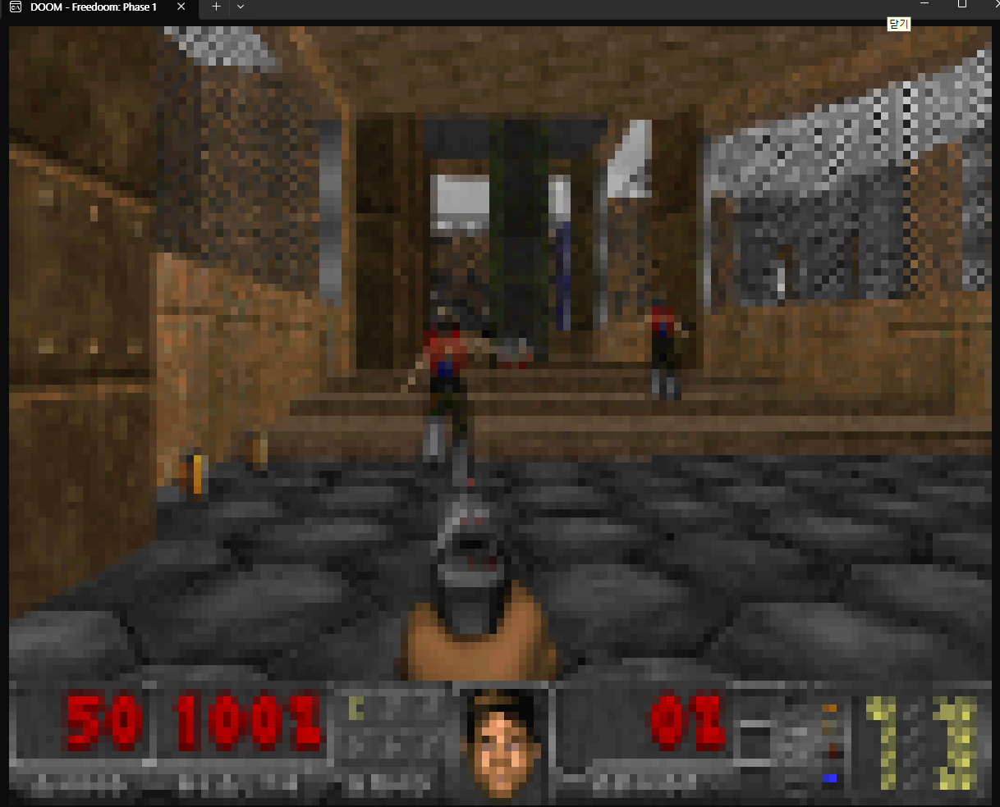

<h1 align="center">CollaboAddons</h1>

<p align="center">Useful extra add-ons for <a href="https://github.com/jkhda456/CollaboCore">CollaboCore</a></p>

<p align="center"><b>English</b> | <a href="readme.ko.md">한국어</a></p>

[CollaboCore](https://github.com/jkhda456/CollaboCore) is an all-in-one WASM sandbox machine: a Linux
kernel running as a native process, a root shell for your agent, your folders mounted, and one network
policy over all of it. This repository collects the optional overlays that go on top of it.

None of that matters, though, because DOOM runs in it. (Yay!)

<p align="center">
  
</p>

## Install

`launcher --addons list` shows which add-ons this repository has and which of them you already have;
`launcher --addons get NAME...` downloads them into the runtime's add-on folder, always the latest:

```
C:\Utils\CollaboCore>launcher.exe --addons list
C:\Utils\CollaboCore>launcher.exe --addons get doom
```

Name an add-on in the `launcher.conf` beside the launcher, and start it as usual:

```ini
addon = doom
# settings for an add-on go as NAME:KEY=VALUE (which also means addon = NAME)
# addon-config = doom:KEY=VALUE
```

The defaults point at the latest release of [`jkhda456/CollaboAddons`](https://github.com/jkhda456/CollaboAddons);
`addons-repo = OWNER/REPO` (or an API URL) in `launcher.conf` names another repository.

Everything else — engine options, mounts, the network policy, logs — belongs to
[CollaboCore](https://github.com/jkhda456/CollaboCore) and its `launcher.conf`; a commented example of
that file is in this repository.
